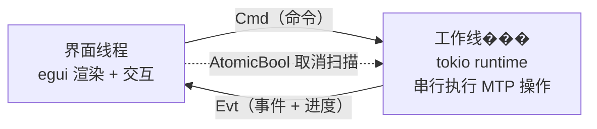

# 📱 phone-tool — 手机照片 USB 读取 & 上传工具

用 Rust 写的小工具：手机通过 **USB** 连上电脑后，以 **MTP（手机上的“文件传输 / MTP”模式）**
读取手机里的文件，**列出全部照片**，勾选后把**照片的全部信息**（可连同照片文件本身）
通过**同一个 HTTP 接口**上传到服务器。

图形界面用 `egui`/`eframe`，MTP 访问用纯 Rust 的 [`mtp-rs`](https://crates.io/crates/mtp-rs)。

---

## ✨ 功能

| 功能                  | 说明                                                                                                                                                                             |
| --------------------- | -------------------------------------------------------------------------------------------------------------------------------------------------------------------------------- |
| 设备发现              | 枚举所有 MTP 设备（手机 / 相机 / 电子书阅读器），显示型号与序列号                                                                                                                |
| 连接设备              | 按序列号或 USB 位置打开设备，读取内置存储 + SD 卡                                                                                                                                |
| 扫描照片              | 递归遍历存储分区，按扩展名 + 设备上报的分辨率识别照片，带进度与取消                                                                                                              |
| 缩略图网格            | 虚拟滚动网格；优先用设备自带缩略图，失败自动回退读原图再缩放                                                                                                                     |
| 照片详情              | 每张照片的全部 MTP 元数据：句柄、父目录句柄、路径、大小、类型、分辨率、创建/修改时间（含 Unix 秒）、所在存储分区                                                                 |
| **EXIF 元数据** | 从照片字节里解析完整 EXIF（相机、镜头、拍摄时间、曝光/光圈/ISO/焦距、方向、GPS 坐标…），界面里按"关键参数 + 全部字段"两级展示；上传时一并 POST，`exif` 字段里带全部条目与 GPS |
| 选择与筛选            | 文件名筛选、最小大小筛选、多种排序、全选/反选                                                                                                                                    |
| 上传                  | 通过**唯一接口** `POST {base}{path}` 上传；元数据必传，照片文件可选                                                                                                      |

> Windows 上 `mtp-rs` 使用系统自带的 **WPD（Windows Portable Devices）COM 栈**，
> **不需要安装任何 USB 驱动**（不用 Zadig、不用 libusb），手机端也不需要装 App。

---

## ✅ 环境要求

- **Windows 10 / 11**
- **手机**：Android（USB 用途选“文件传输 / MTP”）。iOS 不支持 MTP，本工具不适用。
- **Rust** 1.85+（本仓库在 1.96.1 上验证）

---

## 🚀 构建与运行

```powershell
cd g:\andriod-tools
cargo run --release
```

无界面诊断（排查连接/扫描问题时用，输出重定向到文件即可看）：

```powershell
cargo run -- probe *> probe.txt        # 设备/存储/根目录/各目录照片数
cargo run -- exif 6 *> exif.txt        # 前 6 张照片的 EXIF 及上传用的 JSON
```

启动即自动连接并扫描：

```powershell
cargo run -- --auto-connect
```

首次编译会拉取并构建约 400 个 crate（`eframe` + `wgpu` + `reqwest`），耗时较长；之后是增量编译。

如果界面出现方块字，说明没找到中文字体，可显式指定：

```powershell
$env:PHONE_TOOL_CJK_FONT = "C:\Windows\Fonts\msyh.ttc"
cargo run --release
```

---

## 🧭 使用步骤

1. 用数据线把手机接到电脑，解锁屏幕，下拉通知栏把 **USB 用途改成“文件传输 / MTP”**
   （部分机型叫“传输文件”，华为叫“传输照片/文件”，小米在“USB 用途”里选 MTP）。
2. 手机若弹出“**允许访问设备数据？**”，点**允许**。
3. 界面上点 **🔄 刷新设备** → 在设备下拉框选中你的手机 → 点 **🔌 连接**。
   - 连接成功后左侧会列出各存储分区的可用空间。
4. 选择扫描范围 → 点 **🔍 扫描照片**。
   - `全部目录（完整扫描）`：递归整个存储，保证不漏；MTP 每进一个目录要一次 USB 往返，慢。
   - `常见照片目录（快速扫描）`：只进 `DCIM / Pictures / Download / Camera / Screenshots / Tencent / MicroMsg` 等常见目录。
   - 扫描过程中可随时点 **⏹ 取消扫描**。
5. 在中间的照片网格里操作：
   - **左键单击**：勾选 / 取消勾选（左上角出现 ✓），同时把该照片设为“当前详情”。
   - **右键单击**：弹出该照片的**全部信息**窗口。
   - 左侧面板可筛选、排序、全选 / 反选、调整缩略图大小。
6. 在左侧「③ 服务器接口」里填写地址与接口路径，然后：
   - **☁ 上传选中照片（信息+文件）**：`metadata` + `file` 一起发。
   - **📄 仅上传选中信息**：只发 `metadata`，不发文件。
   - 底部日志会逐条显示 `[i/n] 文件名 → HTTP 200 …`。

---

## 🔌 服务器接口协议

**只有一个接口**，元数据必发，文件可选。

```
POST {base_url}{api_path}          # 默认 http://127.0.0.1:8080/api/photo/upload
Content-Type: multipart/form-data; boundary=…
Authorization: Bearer <token>      # 只在填了 Token 时带上
```

### 表单字段

| 字段     | 默认名       | 类型                                                   | 是否必发                                     |
| -------- | ------------ | ------------------------------------------------------ | -------------------------------------------- |
| 元数据   | `metadata` | `text/plain`（内容是 JSON 字符串）                   | ✅ 总是发送                                  |
| 照片文件 | `file`     | 二进制，带`filename` 与 `Content-Type: image/jpeg` | 仅当勾选“上传照片文件本身”且读取成功时发送 |

### `metadata` 的 JSON 结构

```json
{
  "request_id": "0f3a1c4e-9c2b-4d2e-8a71-5f0c9c0d3a11",
  "uploaded_at": "2026-10-12T09:31:02.123+08:00",
  "client": { "name": "phone-tool", "version": "0.1.0" },
  "device": {
    "serial": "1A2B3C4D",
    "location_id": 2147483649,
    "vendor_id": 6353,
    "product_id": 4102,
    "product": "Pixel 9 Pro XL",
    "manufacturer": "Google",
    "model": "Pixel 9 Pro XL",
    "device_version": "17"
  },
  "storage": {
    "id": 65537,
    "description": "内部存储",
    "free_space_bytes": 41123456789,
    "max_capacity_bytes": 128000000000,
    "storage_type": "FixedRam"
  },
  "photo": {
    "object_handle": 4211,
    "parent_handle": 4198,
    "storage_id": 65537,
    "storage_description": "内部存储",
    "filename": "IMG_20261001_123045.jpg",
    "relative_path": "DCIM/Camera/IMG_20261001_123045.jpg",
    "size_bytes": 3421987,
    "mime_type": "image/jpeg",
    "format_code": 0,
    "width": 4032,
    "height": 3024,
    "created_at": "2026-10-01 12:30:45",
    "modified_at": "2026-10-01 12:30:47",
    "created_unix": 1759293045,
    "modified_unix": 1759293047,
    "exif": {
      "field_count": 61,
      "highlights": {
        "Make": "Xiaomi",
        "Model": "MI 9",
        "DateTimeOriginal": "2020:06:19 10:18:13",
        "ExposureTime": "1/100 s",
        "FNumber": "f/1.75",
        "ISOSpeedRatings": "996",
        "FocalLength": "4.75 mm",
        "Orientation": "row 0, col 0"
      },
      "fields": [
        { "ifd": "Primary", "tag": "Make", "id": 271, "value": "Xiaomi" },
        { "ifd": "Primary", "tag": "Model", "id": 272, "value": "MI 9" }
      ],
      "gps": { "latitude": 23.192285, "longitude": 113.384871, "altitude": null }
    }
  },
  "file_included": true
}
```

`exif` 字段说明：

| 字段            | 说明                                                                                                                            |
| --------------- | ------------------------------------------------------------------------------------------------------------------------------- |
| `field_count` | EXIF 条目总数                                                                                                                   |
| `highlights`  | 相机 / 镜头 / 拍摄时间 / 曝光 / 光圈 / ISO / 焦距 / 方向 / 作者… 等关键项的**显示值**（已去引号、已过滤无意义值）        |
| `fields`      | **全部** EXIF 条目，逐条给出 `ifd`（`Primary` / `Thumbnail`）、`tag`、`id`、`value`，服务端可以自己再解析一遍 |
| `gps`         | 拍摄地坐标（经纬度 + 海拔，没有就是`null`）；海拔为 0 视为未测到                                                              |

**读不到 EXIF 时 `exif` 为 `null`**（截图、微信保存的图、部分编辑过的图片本身就没有 EXIF），服务端需要判空。

### 响应

**任意 2xx** 视为成功；其它状态码记为失败（4xx 不重试，5xx / 408 / 429 会按
`失败重试` 次数做指数退避重试）。响应体只用于日志显示，不影响判定。

---

## 🧪 本地参考服务端

仓库里带了一个**零依赖**的 Python 参考实现，用来联调：

```powershell
cd g:\andriod-tools
python server\test_server.py            # 默认监听 127.0.0.1:8080
```

- 照片文件保存到 `server/uploads/<relative_path>`
- 元数据逐行追加到 `server/metadata.jsonl`
- 每个请求打印一行摘要

把界面里的「服务器地址」填 `http://127.0.0.1:8080`、「接口路径」填 `/api/photo/upload` 即可。

---

## 🩺 连不上手机？按顺序排查

### ⚠ 最常见的坑：电脑上还插着 U 盘 / 读卡器

如果电脑上同时插着 U 盘、读卡器、相机等**也能说 MTP 的设备**，而程序又用了“打开第一台设备”
（兜底路径），它可能打开的是**那台 U 盘**，而不是手机。表现就是：**连接看起来成功了，
但一张照片也看不到**（因为 U 盘没有存储分区）。

排查方式：

- 看顶部 “已连接：xxx yyy” 里的型号是不是你的手机；
- 如果程序弹出红色横幅说“没有任何存储分区”，说明接错了，回到下拉框选手机再连；
- 也可以跑无界面诊断确认：

```powershell
cargo run -- probe *> probe.txt     # 结果写入 probe.txt
```

诊断输出会依次告诉你：枚举到哪几台设备、每种打开方式（位置 / 序列号 / 第一台）
分别打开了什么、存储分区、根目录条目、以及每个一级目录里直接包含多少张照片。

### 打开顺序

Windows 上手机以 **WPD（Windows Portable Devices）** 设备枚举，而 `mtp-rs` 的设备列表走的是
原始 USB 描述符枚举，两者不一定对得上，所以程序内置了三级兜底打开顺序：

| 顺序 | 方式                  | 说明                                                                            |
| ---- | --------------------- | ------------------------------------------------------------------------------- |
| 1    | **按 USB 位置** | `open_by_location`，用 VID/PID 关联到 WPD 设备，Windows 上最可靠              |
| 2    | **按序列号**    | 仅当 WPD 序列号 == USB 描述符序列号时有效（Pixel 等机型两者不同）               |
| 3    | **打开第一台**  | 直接枚举 WPD，对应界面上的**⚡ 打开第一台** 按钮，**可能选中 U 盘** |

所以：**优先用「🔌 连接」（会走位置关联）**，「⚡ 打开第一台」只在列表为空时用。

### 其它检查项

1. **列表是空的？** 先关掉可能占用手机的其它软件，再点 **🔄 刷新设备**；
   实在认不到才用 **⚡ 打开第一台**（这一步不走 USB 描述符枚举，而是直接枚举 Windows 的 WPD 设备）。
2. 手机 USB 用途必须是 **“文件传输 / MTP”**，不能是“仅充电”。
   - 华为：传输文件 / 传输照片
   - 小米：USB 用途 → 传输文件(MTP)
   - 三星：USB 用途 → 传输文件
3. 手机要**保持解锁**；插上后若弹出 **“允许访问设备数据？”** 必须点**允许**（没弹窗就拔插一次数据线）。
4. 换一根**能传数据**的线、换一个 USB 口（优先主板直插，别用 Hub / 扩展坞）。
5. 关掉其它占用手机的软件：手机助手、iTunes 类、Android File Transfer、adb 长连接等。
6. 程序日志面板会打印每台设备的信息：
   ```
   发现 1 台 MTP 设备
   · Samsung Galaxy S24 (serial: ABC123, location: 00200000) （VID:PID=04e8:6860，位置 0x00200000，速率 High，匹配原因 StandardClass）
   ```

   “速率 High”说明走的是 USB 2.0（480Mbps），可能是线或口的问题。
7. 顶部出现红色 **⚠ 出错了** 横幅时，上面写的就是 mtp-rs 返回的原始错误，照着提示处理即可。

> 连接超过 30 秒会自动判超时并复位界面，不会一直转圈。

> ⚠ **不要在传输/扫描中直接强制杀掉程序**。MTP 会话没关干净的话，手机上那条连接会卡住，
> 之后所有数据读取都会报 `0x80070141 无法连接至设备`，必须拔掉数据线重插才能恢复。
> 程序退出时会自动 CloseSession，正常关闭窗口就不会有问题。

---

## � 界面开发/调试小工具

`tools/capture.ps1` 可以截取程序窗口（用于改 UI 时对比效果），还支持模拟点击与拖动：

```powershell
# 只截图（窗口必须处于运行状态）
powershell -NoProfile -ExecutionPolicy Bypass -File tools\capture.ps1 -Out ui.png

# 在窗口内点一下（窗口相对坐标，用于自动点按钮）
... -ClickX 800 -ClickY 40

# 拖动（例如测试左侧面板宽度调整）
... -DragFromX 493 -DragFromY 700 -DragToX 760 -DragToY 700
```

> 脚本必须保持纯 ASCII：Windows PowerShell 5.1 按 ANSI/GBK 解析 `.ps1`，中文会导致语法错误。

踩过的布局坑（改 UI 时注意）：

- **面板不要嵌套创建**。`eframe` 0.36 里 `App::ui(&mut Ui, &mut Frame)` 给的是根 `Ui`，
  面板要在里面创建一次；如果外层再包一层同 id 的 `Panel`，egui 会报
  `Second use of widget ID …`，表现为**面板高度异常、拖拽宽度跳动**。
- `egui::Panel::top/bottom/left/right(id).show(ui, …)`，尺寸用 `.default_size(px)`；
  `CentralPanel` 必须最后添加。
- 只允许纵向滚动的区域里放超长文本（日志、详情）会被右边裁掉且拉不出来，
  这类区域要用 `ScrollArea::both()`。
- **缩略图网格没用 `ScrollArea::show_rows`**，而是用 `show_viewport` 自己定位行，原因有两个：
  1. `show_rows` 把内容高度写死成 `(传入行高 + spacing) × 总行数`，传入的行高必须和真实行高
     **完全一致**；不一致时行是按下标画的、高度是按假设算的，滚到列表底部会出现**大片空白**
     （照片越多空白越大）。
  2. 列数必须按滚动区**内部**的可用宽度算（`ui.max_rect()`，已排除滚动条占位）；
     用外面的 `ui.available_width()` 会多算一列、右侧被裁。
     自己定位后：内容高度 = 最后一行底边，列数 = `floor((可用宽 + spacing) / (格宽 + spacing))`，
     每帧重算 ⇒ 拖动面板改宽度时列数自动增减，右侧留白永远小于一个格子宽。
- **在 `ui.horizontal` 里连续 `allocate_exact_size` 是横向并排的**。曾经一个格子先 allocate 图片、
  再 allocate 文字，格子真实宽度就变成了 `格宽 + spacing + 格宽`，列数必然算多。
  现在整格只 allocate 一个矩形，图和文字都用 `painter` 画。
- `f32::at_least` 之类的需要 `NumExt` trait 在作用域内，直接用 `f32::max` 更省事。

---

## 🗂 代码结构

```
src/
├── main.rs       程序入口，创建 eframe 窗口 / 分发命令行模式
├── cli.rs        无界面诊断模式（probe / exif）
├── exif.rs       EXIF 解析、清洗与序列化（含单元测试）
├── app.rs        egui 界面：设备栏 / 扫描面板 / 服务器配置 / 缩略图网格 / 详情 / 日志
├── worker.rs     后台工作线程：MTP 会话、递归扫描、缩略图、上传编排
├── model.rs      数据模型（设备 / 存储 / 照片 / 上传配置），设备与存储实现 Serialize
├── uploader.rs   HTTP 客户端：multipart 上传 + 重试
└── thumbs.rs     缩略图解码、MIME 推断、照片扩展名判定、字节格式化
server/
└── test_server.py  联调用的参考服务端
```

### 线程模型



MTP 设备同一时刻只允许一个会话、一条操作，所以所有设备操作都在工作线程里**串行**执行；
界面只发命令、收事件，渲染永不被 USB 阻塞。

---

## ⚠️ 注意事项与已知限制

- **完整扫描会慢**：MTP 每个目录一次 USB 往返，2 万个文件的机型可能要数分钟，日志与进度会实时刷新。
- **三星机型**：根目录列举受限，`mtp-rs` 会自动回退，速度更慢但不影响结果。
- **HEIC/HEIF/DNG**：能扫描到、能上传，但界面里**无法预览缩略图**（`image` crate 不解码 HEIC），会显示“无法预览”。
- **单文件上限**：默认 64 MB，超过则本次只上传信息，日志里会注明。
- **照片文件是整张读进内存再上传**的（一张一张处理），所以内存峰值约等于单张照片大小。
- **时间字段**：多数手机写入 MTP 时间时**不带时区**，程序用本机时区换算 Unix 秒；若需要精确时间请以 `created_at` / `modified_at` 原字符串为准。
- 只读取，不修改/删除手机上的任何内容。

---

## 📄 License

MIT
